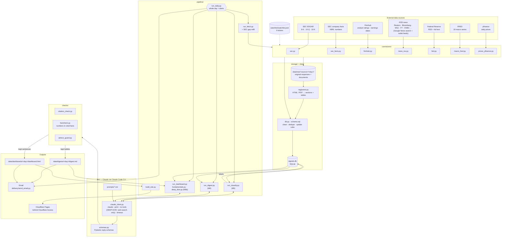
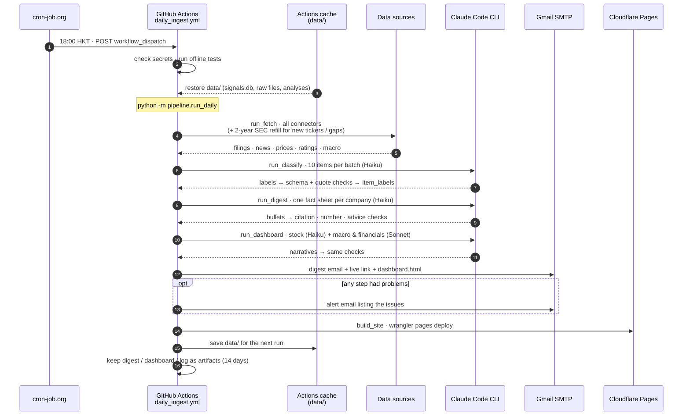
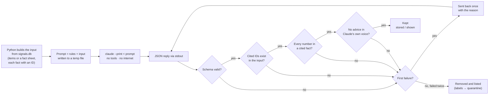
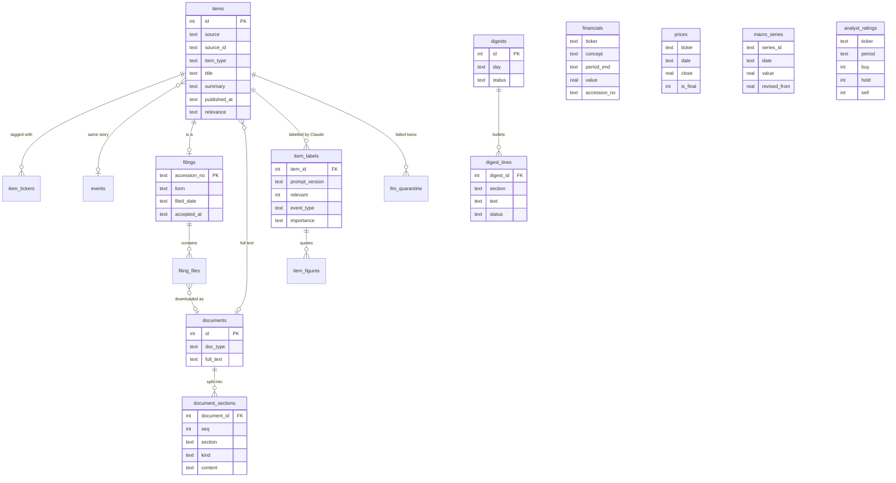

# Investment Signal Agent (simulation)

A daily research pipeline for a stock watchlist: it collects SEC filings, headlines from major outlets (RSS), prices, analyst rating counts and macro data, has Claude label and summarise them, checks every number Claude writes against its source, and delivers a cited digest by email plus a private interactive dashboard.

> **Simulation, not investment advice.** The system never says buy, sell or hold in its own voice.

**Status:** Part 1 (milestones 1–7) is running daily on GitHub Actions. Part 2 (RAG over filings + research agent) is next. Full design notes: [`mission-control.md`](mission-control.md).

---

## 1. System architecture



**How to read it:** connectors fetch everything for the tickers in `watchlist.json`, keep the original responses in `data/raw/`, and store cleaned rows in `signals.db`. Three Claude jobs (classify, digest, dashboard narratives) read only what Python hands them from the database, and every answer goes through the checks before it reaches the digest, the dashboard or the email.

---

## 2. Daily run (GitHub Actions)



---

## 3. How every Claude answer is checked



---

## 4. Data model (main tables)



Also stored: `earnings_calendar` (+ `earnings_changes`), `series_info`, `sec_coverage` (filing-history coverage per ticker), `llm_runs`, `dashboards`, `deliveries`, `daily_runs`, `fetch_runs`. Every table has a unique key, so re-running a day adds no duplicates.

---

## 5. Repository layout

```
.
├── watchlist/watchlist.json      # the tickers every connector reads
├── config/                       # fred_series.json, news_sources.json (allowed news outlets)
├── connectors/                   # one file per data source (fetch(day) -> items)
├── storage/                      # schema.sql, db.py (save + update rules), inspect_db.py
├── rag/parse.py                  # filings -> text blocks, tables as rows, split by Item
├── llm/                          # claude_client.py, schemas.py, prompts/*.md
├── checks/                       # citation_check, factcheck, advice_guard
├── pipeline/                     # run_fetch, run_classify, run_digest, run_dashboard,
│                                 # fundamentals, build_site, run_daily, dashboard_template.html
├── delivery/send_email.py        # Gmail SMTP: digest + attachment, alerts, no double send
├── tests/                        # offline tests (fake Claude, fake mail server, fixtures)
├── .github/workflows/daily_ingest.yml
└── mission-control.md            # design notes, decisions, milestones
```

---

## 6. Running it locally

```bash
python -m venv venv && venv\Scripts\activate      # Windows
pip install -r requirements.txt
npm install -g @anthropic-ai/claude-code           # Claude Code CLI (sign in once)
copy .env.example .env                             # then fill in the keys

python -m pipeline.run_daily --dry-run             # whole day, email saved to data/outbox/
python -m pytest -q                                # offline tests
```

Single steps: `pipeline.run_fetch`, `pipeline.run_classify`, `pipeline.run_digest`, `pipeline.run_dashboard`, `delivery.send_email --dry-run`, `storage.inspect_db --duplicates`.

**Keys** (names in `.env.example`): `SEC_USER_AGENT`, `FINNHUB_API`, `FRED_API`, `SMTP_USER`, `SMTP_PASSWORD` (Gmail app password), `DIGEST_TO`. On a laptop signed in to Claude Code no Claude key is needed; in the cloud, `CLAUDE_CODE_OAUTH_TOKEN` from `claude setup-token`.

## 7. Running it in the cloud

GitHub Actions runs `daily_ingest.yml` when cron-job.org calls the GitHub API every day at 18:00 HKT. `data/` is kept between runs in the Actions cache. Secrets: the keys above plus `CLAUDE_CODE_OAUTH_TOKEN`, `CLOUDFLARE_API_TOKEN`, `CLOUDFLARE_ACCOUNT_ID`. The dashboard is published to Cloudflare Pages and protected by Cloudflare Access (owner's email only).

## 8. Roadmap

| Part | Milestone | Status |
| --- | --- | --- |
| 1 | M1–M4 Connectors + database | Done |
| 1 | M5 Claude classification + SEC company facts | Done |
| 1 | M6 Digest with fact check · M6b Dashboard | Built |
| 1 | M7 Email, GitHub Actions, live dashboard | Built |
| 2 | M8 RAG over filings (chunk, embed, cited answers) | Next |
| 2 | M9 Research agent (LangGraph, tools, approval) | Planned |
