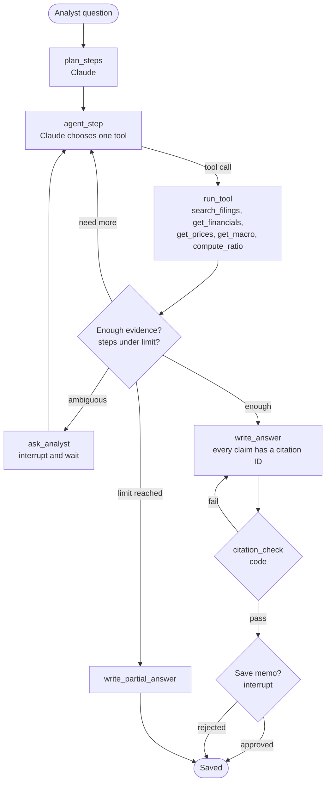

# Mission Control: Investment Signal Agent (Simulation)

**Status:** Milestones 1–5 done; Milestone 6 (daily digest with fact check) and 6b (interactive dashboard) built, waiting for the owner's review. Some database rules are not yet verified with real data (see section 5). Milestone 7 (delivery and scheduling) is next, to be confirmed after the dashboard review.
**Owner:** You
**Last updated:** 2026-11-10

---

## 1. Mission and guardrails

**Mission.** Each trading day, collect public company filings, news, prices, analyst ratings, and macro data for a six-stock watchlist. Turn them into a cited digest for a portfolio manager, and answer follow-up questions from the stored documents.

**Watchlist (simulation only, changed 2026-11-12):** AAPL (Apple), CI (Cigna), FN (Fabrinet), GOOG (Alphabet), GRAB (Grab Holdings), META (Meta), NVDA (Nvidia), SPY (SPDR S&P 500 ETF), WFC (Wells Fargo). Previous: AMD, ANET, NET, UI, PLTR, AAPL (their data is kept; fetching stopped). Kept in `watchlist/watchlist.json`; every connector reads it. No size limit.

**Hard rules**

1. The system never says buy, sell, or hold in its own voice. A check script blocks those words in every output. Exception: analyst ratings may be reported as third-party data, always attributed and cited (for example, "Finnhub analyst counts, Nov 2026: 12 strong buy, 19 buy, 8 hold [source]").
2. Every number Claude writes in a digest must appear in the source it cites (check 1). A bullet that still fails after one retry is removed and listed under "Removed by fact check". The whole digest is blocked only if a Python-built part (tables, disclaimer) is broken.
3. Every claim cites a source: a filing page, a news URL, or a data series ID.
4. Every output is labelled as a simulation and is not investment advice.
5. Paywalled content (for example, WSJ) is never scraped or stored in full. News is stored as headline + publisher summary only.
6. Secrets live only in `.env` or GitHub Secrets. Never in code, logs, or commits.

---

## 2. Vendors and connectors

| # | Connector | Purpose | Auth (env var) | Free tier notes (tested 2026-11-10) | Status |
|---|---|---|---|---|---|
| 1 | SEC EDGAR (`connectors/sec.py`) | 8-K, 10-Q, 10-K (+ amendments) with the full text of the main document and every text exhibit | `SEC_USER_AGENT` (no key) | Free. Max 10 requests/sec (we use 8). Descriptive User-Agent required. | Built |
| 2 | Finnhub (`connectors/finnhub.py`) | Company news, general market/macro news, analyst rating counts, earnings calendar | `FINNHUB_API` | ~60 calls/min. Headline + summary only (max ~500 chars). Press releases, upgrades/downgrades and price targets are paid (HTTP 403). Earnings calendar caps at 1,500 rows per call (connector splits the date range). | Built |
| 3 | NewsData.io (`connectors/newsdata.py`) | Second news source: headlines naming watchlist companies | `NEWSDATA_API` | ~200 credits/day, 10 articles per credit. Headline search (`qInTitle`) only; ticker search, archive, full content and AI summary are paid. News delayed ~12 hours. | Built |
| 4 | Federal Reserve (`connectors/fed.py`) | FOMC statements, minutes, speeches, testimony, **full text** | none | Free RSS + public-domain pages. | Built |
| 5 | FRED (`connectors/macro_fred.py`) | Macro series listed in `config/fred_series.json` (rates, yields, inflation, jobs, growth, markets) | `FRED_API` | Free key, 120 requests/min. Key must be in the URL, so it is scrubbed from error messages. | Built |
| 6 | yfinance (`connectors/prices_yfinance.py`) | Daily prices and volume for the watchlist + S&P 500 and Nasdaq-100 | none | Unofficial wrapper around Yahoo Finance. Can break without notice. Personal, non-commercial use. | Built |
| 7 | Claude via the Claude Code CLI (`llm/claude_client.py`) | Classification (M5), digest (M6), Q&A (M8) | Logged-in Claude Code account, or `CLAUDE_CODE_OAUTH_TOKEN` (from `claude setup-token`) | Uses your subscription. `claude --print`, no tools, prompt via temp file + `<`, reply through the pipe. `ANTHROPIC_API_KEY` is removed from Claude's environment so nothing is billed to the API. Model `claude-haiku-4-5-20251001`, effort low, thinking off. Token may expire. | Built (M5) |
| 7b | SEC company facts (`connectors/sec_facts.py`) | Official 10-K / 10-Q numbers (XBRL) into `financials`, for the fact check | `SEC_USER_AGENT` | Free, one file per company (1–4 MB). Only 10-K / 10-Q: an 8-K press release is not tagged, so new results appear only once the 10-Q / 10-K is filed. | Built (M5) |
| 8 | Embedding model (local) | Turns text into vectors for search | none | Free. Runs on CPU. Example: a bge-small or MiniLM sentence-transformers model. | Planned (M8) |
| 9 | Economic calendar | When macro releases happen | TBD | Finnhub calendar is premium. Options: financecalendar.com (free tier, attribution required) or FRED release dates. | Later |
| 11 | Live dashboard: Cloudflare Pages + Cloudflare Access (planned) | Hosts the latest `dashboard.html` at a private link, updated by every run; login by one-time code to the owner's email only | `CLOUDFLARE_API_TOKEN`, `CLOUDFLARE_ACCOUNT_ID` (GitHub secrets) | Free: Pages unlimited bandwidth, 500 deploys/month; Access free up to 50 users (sign-up may ask for a card, nothing charged) | Built (M7, section 13a) |
| 10 | Delivery: Gmail SMTP (`delivery/send_email.py`) | Emails the daily digest (body) with the dashboard attached; alert emails | `SMTP_USER`, `SMTP_PASSWORD` (Gmail app password), `DIGEST_TO` (+ `SMTP_HOST`, `SMTP_PORT`) | Own Gmail to itself. App password needs 2-Step Verification; revocable any time. Gmail limit 25 MB per email (today ~7.7 MB) | Built (M7); scheduling on GitHub Actions to do |

**Removed:** Financial Modeling Prep (FMP). Dropped on 2026-11-10 to keep the project simple; Finnhub + NewsData cover news.

**Connector rules (apply to every connector)**

- One class per vendor, implementing `fetch(day) -> list[Item]`. Watchlist from `watchlist/watchlist.json`.
- Read credentials from environment variables only. Keys go in headers where the API allows it, never in logs.
- Respect each vendor's rate limit. Retries with exponential back-off.
- Save the raw response to `data/raw/<source>/<day>/` before cleaning it. Write the cleaned list to `items.json`.
- If a ticker has nothing on the requested day, return its latest earlier data, marked `is_latest_fallback`.
- Log counts and errors per run (`fetch_runs`). A failed connector never stops the others.
- Keep one recorded sample response per connector in `tests/fixtures/` for offline tests.

---

## 3. Architecture overview

```
 Sources                 Connectors                Raw store (files)           Database (SQLite now, Postgres at M8)
 ───────                 ──────────                ─────────────────           ─────────────────────────────────────
 SEC EDGAR  ───────────► sec.py            ──┐
 Finnhub    ───────────► finnhub.py        ──┤
 NewsData   ───────────► newsdata.py       ──┼──► data/raw/<source>/<day>/ ──► clean + save ──► items, filings, documents,
 Fed        ───────────► fed.py            ──┤    + documents (full texts)     (storage/db.py)   document_sections, prices,
 FRED       ───────────► macro_fred.py     ──┤                                                   macro_series, analyst_ratings,
 yfinance   ───────────► prices_yfinance.py──┘                                                   earnings_calendar, events
                                                                                                       │
                                   ┌───────────────────────────────────────────────────────────────────┤
                                   ▼                                                                   ▼
                         Daily pipeline (plain Python)                                   Research agent graph (LangGraph)
                         fetch → classify → digest + checks → send (M7)                  question → plan → tools → answer
                                   │                                                     → citation check → save (approval)
                                   ▼                                                                   ▼
                         Email / Slack                                                   CLI or FastAPI endpoint
```

**Today:** `python -m pipeline.run_fetch` runs every connector and saves to `data/signals.db`.
**Orchestration (M7):** GitHub Actions (or a local scheduler) runs the daily fetch + digest. The research agent runs on demand.

---

## 4. Folder structure

```
AI News Screening/
├── mission-control.md          # this file
├── README.md
├── requirements.txt
├── .env                        # secrets (git-ignored)
├── .env.example                # variable names only, no values
├── .gitignore
├── watchlist/
│   └── watchlist.json          # tickers (+ optional search name); read by every connector
├── config/
│   ├── fred_series.json        # FRED series to download
│   └── sources.yaml            # (unused so far)
├── connectors/
│   ├── base.py                 # Item model, Connector base, watchlist loader, time format, headline cleaning
│   ├── sec.py
│   ├── sec_facts.py            # SEC company facts -> financials (M5)
│   ├── finnhub.py
│   ├── newsdata.py
│   ├── fed.py
│   ├── macro_fred.py
│   └── prices_yfinance.py
├── pipeline/
│   ├── run_fetch.py            # python -m pipeline.run_fetch  (all connectors -> database)
│   ├── run_classify.py         # python -m pipeline.run_classify  (Claude labels new items, M5)
│   ├── run_digest.py           # python -m pipeline.run_digest  (fact sheets -> Claude bullets -> checks -> digest.md, M6)
│   ├── run_daily.py            # python -m pipeline.run_daily  (fetch -> classify -> digest -> dashboard -> email + alerts, M7)
│   ├── run_dashboard.py        # python -m pipeline.run_dashboard  (charts + checked narratives + news table -> dashboard.html, M6b)
│   ├── dashboard_template.html # page layout + JavaScript (Plotly) filled in by run_dashboard.py
│   ├── fundamentals.py         # FINANCIALS screen: 3 statements from `financials` + what Claude reads (MD&A, risk factors)
│   ├── state.py                # LangGraph state definitions (M5+)
│   ├── ingest_graph.py         # daily graph (M5+)
│   ├── research_graph.py       # research agent graph (M9)
│   └── nodes/
├── llm/
│   ├── claude_client.py        # runs `claude --print` (no tools, timeout, kills the process tree), up to 10 at once
│   ├── schemas.py              # Pydantic reply schema + Python checks (tickers, quotes really in the text)
│   └── prompts/                # classify.md (classify-v1), digest.md (digest-v1), dashboard_stock.md + dashboard_macro.md (dashboard-v1), dashboard_fin.md (fin-v1)
├── rag/
│   ├── parse.py                # HTML/text/PDF -> text blocks, tables as rows, split by Item section
│   ├── chunk.py, embed.py, store.py, retrieve.py   # (M8)
├── delivery/
│   └── send_email.py           # Gmail SMTP: digest email + dashboard attachment, alerts, no double send (M7)
├── checks/                     # factcheck.py (check 1), citation_check.py, advice_guard.py (M6)
├── storage/
│   ├── schema.sql
│   └── db.py                   # connect(), save_items(), group_events()
├── data/                       # git-ignored
│   ├── signals.db              # the database
│   ├── raw/<source>/<day>/     # original API responses + items.json; sec/ and fed/ also hold documents/
│   ├── llm/<day>/              # classify/<run>/<TICKER>_batchNN_input.json + _output.json; quarantine/<run>/
│   ├── digests/<day>/          # <SECTION>_input.json (fact sheet), _output(_retry).json, digest.md, digest.json, factcheck_report.json
│   ├── dashboards/<day>/       # dashboard.html (one offline file, ~5.6 MB with Plotly inside), dashboard.json, <PART>_input/_output.json
│   ├── outbox/                 # --dry-run emails saved as .eml
│   ├── logs/<day>.log          # daily run log
│   └── fundamentals/<TICKER>/  # <accession>_fin-v1.json: Claude's financial analysis, written once per 10-Q / 10-K
├── tests/
│   ├── fixtures/               # one saved real response per connector
│   └── test_*.py
└── .github/workflows/
    └── daily_ingest.yml        # (M7)
```

---

## 5. Data model

**Two copies by design.** `data/raw/` keeps the original responses (for audit and re-processing). The database holds the cleaned data that everything downstream reads. Raw files are never deleted.

| Table | One row = | Unique key | On re-run |
|---|---|---|---|
| `fetch_runs` | One connector run (status ok/degraded/failed, counts, errors) | id | New row each run |
| `items` | One news story, market story, SEC filing or Fed release (title, summary, publisher, url, published_at, sentiment, relevance, event_id, document_id) | (source, source_id) | Never duplicated; only `last_seen_at` updates |
| `item_tickers` | One ticker linked to one item | (item_id, ticker) | New links added |
| `events` | One real-world story across sources | id | Grouping step links copies |
| `filings` | One SEC filing (form, dates, 8-K items, index URL) | accession_no | Never duplicated |
| `filing_files` | Every file inside a filing, downloaded or not (type, description, size, skip reason) | (accession_no, file_name) | Never duplicated |
| `documents` | One full text (SEC main document or exhibit, Fed release) | (source, source_ref) | Never duplicated |
| `document_sections` | One text or table block of a document, labelled with its section ("Item 1A", "Part I Item 2", "Item 2.02") | (document_id, seq) | Rebuilt only if extraction is re-run |
| `prices` | One ticker (or benchmark), one trading day | (ticker, date, source) | Replaced only while `is_final = 0` (session still open) or if adj_close changed by more than 0.02% (a real dividend/split re-adjustment; smaller differences are Yahoo rounding noise) |
| `macro_series` | One FRED value on one date | (series_id, date) | A revised value replaces the old one, kept in `revised_from` |
| `series_info` | One FRED series (label, group, units, frequency) | series_id | Updated |
| `analyst_ratings` | One ticker, one month (strong buy … strong sell counts) | (ticker, period, source) | Updated if the counts change |
| `earnings_calendar` | One ticker, one fiscal quarter: report date, timing, EPS and revenue estimates **plus the previous two values of each, with the date seen**, actuals | (ticker, fiscal_year, fiscal_quarter, source) | Shift current → prev1 → prev2 on change |
| `earnings_changes` | Every change to an earnings row | id | New row per change |
| `financials` | One value from the SEC company-facts API, **exactly as SEC reports it** (no derived numbers, no Q4 maths): concept, unit, period start/end, value, form, accession, filed date. `fiscal_year`/`fiscal_period` belong to the filing, not the fact: use the period dates | (ticker, taxonomy, concept, unit, period_start, period_end, accession_no) | Never duplicated; new filings add rows |
| `item_labels` | Claude's labels for one item: relevant, tickers, event type, importance + reason, sentiment, fiscal period (as written), near-duplicate of, one line | (item_id, prompt_version) | Labelled once per prompt version; a new version adds rows |
| `item_figures` | One number Claude found in an item, with the exact quote (checked to be in the item's text) | id | Added with the label |
| `llm_runs` | One Claude call (batch, model, seconds, tokens, input/output file, status) | id | New row per call |
| `llm_quarantine` | An item whose Claude output failed the checks twice, with the reason | id | Not retried daily; `--retry-quarantine` retries |
| `chunks` | RAG chunks + embeddings | — | Planned (M8) |
| `digests` | One digest per day (status ok / partial / blocked, items used, bullets kept / removed, file path) | day | Re-building a day replaces it |
| `digest_lines` | Every bullet Claude wrote, kept or removed, with its citations, check result and attempt (1 or 2) | id | Replaced with its digest |
| `dashboards` | One dashboard per day (status, news rows, narrative sentences kept / removed, file path) | day | Re-building a day replaces it |
| `sec_coverage` | One ticker: when its filing history was (re)loaded and the last day a daily SEC fetch covered it | ticker | New ticker or a gap > 3 days → filings (re)loaded on the next fetch |
| `deliveries` | Every email sent or attempted (digest / alert, subject, status sent / failed / dry_run, error without password) | id | New row per email; a 'sent' digest row stops a second send that day |
| `daily_runs` | One daily run: each step's status, time and summary, the issues list, log path | id | New row per run |
| `feedback` | User votes on digest items | — | Planned (M10) |

**Data rules**

- **Time:** moments are `YYYY-MM-DDTHH:MM:SSZ` (UTC) everywhere; calendar dates (trading day, filing date, observation date) are `YYYY-MM-DD` and never shifted. Converted to Hong Kong time only for display.
- **Empty values:** empty strings and paid-plan placeholders ("ONLY AVAILABLE IN PAID PLANS") are stored as NULL.
- **Same story:** same ticker + same cleaned headline + published within 48 hours → one `event`. Headlines are cleaned by code (lowercase, drop a trailing " - Publisher", drop punctuation), not by Claude.
- **Relevance:** every matched story is stored; Claude marks relevance (M5, `items.relevance` + `item_labels`). Nothing is deleted. `items.sentiment` keeps the source's own label (NewsData); Claude's sentiment is in `item_labels`.
- **Fiscal years differ** (from SEC `fiscalYearEnd`): AAPL late September, UI June 30, AMD late December, ANET / NET / PLTR December 31. Fiscal periods are stored exactly as written ("fiscal Q1 2027") and never converted to calendar quarters.
- **What Claude reads per source (M5 classification).** The exact content of each batch is saved in `data/llm/<day>/classify/<run>/<TICKER>_batchNN_input.json`:

  | Source | What Claude gets in the prompt |
  |---|---|
  | Finnhub company + market news | Headline, summary (max ~500 chars), publisher, published time, tagged tickers (Finnhub returns every story that *mentions* the ticker, even only in the summary) |
  | NewsData | Headline, description (unless a paid-plan placeholder), publisher, time, tagged tickers (tagged by our code: company name in the headline) |
  | SEC 8-K | Form, company, report date, 8-K item numbers, the 8-K's Item text (first 1,500 chars, cover page skipped), then the first ~2,500 chars of the press release (EX-99.x) |
  | SEC 10-Q / 10-K | Form, company, period, the first 3,000 chars of the MD&A (10-Q Part I Item 2, 10-K Item 7) |
  | Federal Reserve | Release type, title, description, the first 3,000 chars of the full text |
  | Every batch | Up to 20 earlier headlines for the same ticker from the previous 48 hours (`recent_items`), only to spot copies |

  Claude labels **every item that has no label yet**, whatever its date (not only today's): the first run took the backlog; daily runs take what the fetch added. Labels per item: `relevant`, `tickers`, `event_type`, `importance` + reason, `sentiment`, `fiscal_period`, `figures` (with quotes), `near_duplicate_of`, `one_line`.
- **Claude classification (M5):** Python picks unlabelled items (the 2-year SEC backfill is skipped), groups them by ticker, 10 per batch, writes the input file, pastes it into the prompt, and saves Claude's reply. Claude has no tools. Python checks each item: schema, tickers on the watchlist, every figure's quote really in the item's text. Fail → retried once → `llm_quarantine`.
- **SEC documents:** the main document and every text exhibit (including PDFs) are downloaded and stored. Images, XBRL data files, viewer pages and the duplicate full-submission file are recorded in `filing_files` but not downloaded. Tables are kept as rows. 10-K/10-Q/8-K main documents are split by Item; if sections can't be found reliably, the text is kept whole and flagged (`sections_found = 0`).
- **Removed tickers:** data is kept; fetching stops.
- **No `raw_items` table:** the raw files on disk are the originals; rows point to them by path.

**Verified with real data (2026-11-10):** no duplicates in any table (`python -m storage.inspect_db --duplicates`); re-runs add only genuinely new rows; all `published_at` values in UTC `...Z`; Finnhub + NewsData copies of the same story grouped into one event; unfinished price bars refreshed while finished days stay untouched; all full 10-K / 10-Q / 8-K documents split by section (one 10-K/A kept whole and flagged); 24 offline tests pass.

**Not yet verified with real data** (rule built and covered by an offline test, but the situation has not happened yet). Check each when it first occurs, then move it to the verified list:

| Area | Rule | What has not happened yet | How to check when it does |
|---|---|---|---|
| `earnings_calendar` estimate history | New estimate → current moves to `prev1`, `prev1` to `prev2`; every change logged in `earnings_changes` | No estimate has changed since the first fetch; `*_prev1`, `*_prev2` and `earnings_changes` are empty | After a run, `SELECT * FROM earnings_changes`; check the `prev` columns of that ticker |
| `macro_series` FRED revisions | A revised value replaces the old one; old value kept in `revised_from` with `revised_at` | No series has been revised since the first fetch; `revised_from` is empty everywhere | After a CPI or payrolls release, `SELECT * FROM macro_series WHERE revised_from IS NOT NULL` |
| `prices` dividend/split re-adjustment | adj_close changes > 0.02% update the stored row | No dividend or split since the first fetch | After a watchlist company's ex-dividend date, compare adj_close history before/after |
| `document_sections` table extraction | Tables kept as rows (`cell | cell | cell`), "$" / ")" / "%" glued to numbers | Only Ubiquiti's press release tables were checked by eye; the other ~480 documents' tables have not been reviewed | Spot-check tables from each company (10-K Item 8, 10-Q Part I Item 1, EX-99.1) before RAG (M8); fix the extractor and re-run on the saved raw files if needed |
| `events` story grouping | Same ticker + same cleaned headline + within 48 hours | Only identical headlines are grouped (5 pairs so far); differently worded copies of the same news stay separate by design | Now covered by Claude's `near_duplicate_of` (M5: 45 flagged in the first run, e.g. 4 copies of Ubiquiti's results linked to one item). Spot-check that flagged pairs really are the same story |
| `item_labels` quality | Haiku labels: relevance, tickers, importance | First run checked by eye only (206 items): mostly right, e.g. Nvidia/Google stories tagged AMD were marked irrelevant. No clear miss found yet (item 31, first suspected, is fine: its headline says "AMD Rises 4%"; "high" importance is debatable) | Review labels of 1–2 more days before M6; if errors repeat, tighten `classify.md` (bump to classify-v2) |
| `financials` | Stored exactly as SEC reports it (not used by the digest; for M8/M9) | Checked against Ubiquiti FQ1 FY27 only (revenue 1,026,248,000, diluted EPS 5.29, net income 320,463,000, gross profit 485,348,000: all match the press release) | Check one figure per company before M6 relies on it |
| SEC acceptance times | EDGAR's `...Z` times treated as UTC | Confirmed on one filing only (Ubiquiti 8-K) | Compare a few more filings with the matching press release times (open question 5) |

---

## 6. Pipeline and LangGraph structure

**Decision 2026-11-10:** the daily pipeline is plain Python (fixed steps, no loops, no approval pause). LangGraph is used only for the research agent (6.2), where Claude chooses its own steps in a loop.

### 6.1 Daily pipeline (plain Python)

```
python -m pipeline.run_fetch      # 1. every connector -> data/raw + signals.db (+ group events)
python -m pipeline.run_classify   # 2. Claude labels new items (M5)
python -m pipeline.run_digest     # 3. fact sheets -> Claude bullets -> Python checks -> digest.md (M6)
python -m pipeline.run_dashboard  # 4. charts + checked narratives + digest as news table -> dashboard.html (M6b)
python -m pipeline.run_daily      # (M7) all of the above + email; this is what the schedule runs
```

**How the digest is built (M6)**

1. **Items:** relevant + high/medium importance (M5 labels), first seen since the previous digest (first digest: last 7 days), published within the last 7 days, one entry per story (copies shown as "Also reported by"). Low importance is left out completely.
2. **Fact sheet per company with news, plus one for MARKET:** a small extract of `signals.db`, each fact with an ID: `N` news, `S` SEC filing excerpt, `F` Fed text, `P:<ticker>` prices (Python works out 1d / 5d / YTD %, distance from the 52-week high, volume vs the 20-day average), `R:<ticker>` Finnhub analyst counts, `E:<ticker>` next earnings, `M:<series>` FRED. Saved as `data/digests/<day>/<SECTION>_input.json`. Companies with no news get no Claude call (they appear in the tables only).
3. **Claude** (Haiku 4.5, effort low, thinking off, no tools; one call per section, in parallel) replies with bullets: `{"text": ..., "cites": [...]}`. Python writes `<SECTION>_output.json`.
4. **Python checks every bullet:** citation check (every cited ID exists in that sheet), check 1 (every number is in a cited fact's text), advice guard (no buy / sell / hold / "should" / price target in its own voice; allowed only when attributed and citing news or analyst counts). A failed bullet goes back to Claude once with the reason (Claude does not read the database: Python sends the same fact sheet again); still failing → removed and listed.
5. **Python renders** `digest.md`: disclaimer, market bullets + macro table, watchlist snapshot table, company bullets, coming-up earnings (14 days), data freshness (a source not updated for 24 hours is flagged STALE), numbered sources, "Removed by fact check". Also `digest.json`, `factcheck_report.json`, and the `digests` / `digest_lines` tables.

**The dashboard (M6b)**

One self-contained HTML file per day (`data/dashboards/<day>/dashboard.html`, Plotly inside, opens offline). The digest (`digest.md`) stays as it is and is the text version (M7 email body).

| Area | Content |
|---|---|
| Top bar | Stock dropdown (All / each ticker / Market & macro), date, disclaimer, data freshness (hover for each source) |
| Right half: news table | **The checked digest**: one row per kept bullet. Columns: ticker (dot = high / medium importance), date, title (headline of the cited source), summary (Claude's checked bullet), links (every cited source). Filtered by the stock dropdown; click a header to sort |
| Left top: prices | Stock dropdown, period buttons 1M / 3M / 6M / YTD / 1Y / All over all downloaded history, candlestick + volume, or "vs S&P / Nasdaq" (% from the start of the period). **Claude narrative: the last month** (Python-computed month move vs both indices, month high / low, volume; the stock's relevant news of the last 30 days; analyst counts; next earnings). Haiku |
| Left bottom: Fed & macro | Series dropdown (all FRED series + a yield-curve snapshot), period buttons 3M / 6M / 1Y / 2Y / All. Chart type by data: step line (policy rates), line (yields, unemployment, dollar, oil), area (spreads), year-over-year % bars (CPI, core CPI, core PCE), monthly change bars (payrolls), annualised quarterly % bars (GDP), line + 4-week average (claims), VIX with calm / elevated / stressed bands, yield curve now vs 3 months vs 1 year ago. **Claude narratives (Sonnet, `claude-sonnet-5-5`): one big picture** connecting the latest update of every series + the Fed releases (latest FOMC statement always, other Fed releases of the last 30 days) + macro news of the last 7 days; **and a note per series**: its latest update and its role in that picture |

**Screen 2: FINANCIALS** (key `2 FINANCIALS` in the header; `1 MARKET` goes back)

| Area | Content |
|---|---|
| Controls | Security, Period (quarterly / annual), Show (4 / 8 / 12 quarters or 3 / 5 / 6 years), Statement (All / IS / BS / CF / RATIOS) |
| Left: the three statements | From `financials` (SEC company facts), exactly as reported (latest filed value if restated), USD millions. Each line has a list of SEC tags because companies tag the same line differently; the tag covering the most shown periods wins. Not reported → "—". **Income statement:** 3-month quarters + full years; **Q4 shows "Q4 → annual"** (no subtraction). **Balance sheet:** every quarter end. **Cash flow:** quarterly columns are **year-to-date as filed** (3M / 6M / 9M / 12M row). **Ratios** (gross / operating / net margin, free cash flow = operating CF − capex, current ratio, LT debt / equity) computed by Python, tagged *computed*. Fiscal labels per company (Q1 FY2027…). Every number links to its filing; trend sparkline per row |
| Right: Claude's analysis | **Sonnet**. Reads the statements (as text), the ratios, the latest MD&A (10-Q Part I Item 2 / 10-K Item 7, up to 45k chars), the latest 10-K risk factors (Item 1A, up to 45k chars) and the latest 10-Q risk-factor update. Writes an **overall picture** (how growth and profitability turn into cash and shape the balance sheet, which risk factors matter, where numbers and management agree or disagree) and 3–5 sentences per statement tied back to it. Checked like everything else |
| When it runs | Statements: every build. Analysis: **once per filing**, cached in `data/fundamentals/<TICKER>/<accession>_fin-v1.json`, reused until the next 10-Q / 10-K. `--refresh-fin [TICKER ...]` rewrites it |

Every narrative sentence is checked exactly like a digest bullet (citations exist, every number in a cited fact, advice guard), one retry, then dropped and listed. Python splits a paragraph Claude packs into one "sentence" so each sentence is checked on its own. Narratives do not change with the period buttons (written once per day). `--no-claude` rebuilds charts and table and reuses the narratives already saved that day. Deep link: `dashboard.html#ticker=UI&series=CPIAUCSL&mode=relative&stock=UI`.

**Failure behaviour**

- A connector with errors is marked `degraded` (or `failed`) in `fetch_runs`. The other connectors still run.
- An invalid classification is quarantined, not dropped, so you can review it.
- A digest bullet that fails twice is removed and listed; the digest still goes out. A Claude call that fails twice leaves that section with a note (digest status `partial`). A broken Python part (table, disclaimer) blocks the whole digest (status `blocked`).
- Any source that is more than 24 hours late is flagged in the digest.

### 6.2 Research agent graph

**State fields:** `question`, `plan`, `messages`, `tool_results`, `steps`, `max_steps`, `answer`, `citations`, `needs_user`, `approved`



**Controls**

- `max_steps` is 6 by default.
- Tools are allowlisted. The agent cannot call anything else.
- `compute_ratio` is a plain function. The model never does arithmetic.
- `save` always requires approval.
- Checkpoints are stored, so a run can resume after an interruption.

### 6.3 LangChain versus LangGraph: who does what

| Concern | Use | Why |
|---|---|---|
| Graph, state, routing, approvals, checkpoints | LangGraph | Explicit control flow that is easy to show in an interview |
| Claude model wrapper, tool binding | LangChain (`langchain-anthropic`) | Standard interface for tool calls and structured output |
| Document parsing and section splitting | Plain code (`rag/parse.py`) | Custom Item-section rules for SEC forms |
| Vector store | LangChain PGVector integration, or direct SQL | Direct SQL is simpler to debug at this size |
| Retrieval | Plain code (metadata filter, then hybrid search, then rerank) | Full control over filters and citations |
| Numbers, rules, schedules | Plain Python | Never a framework's job |

*Check package names and versions when you install. They change often.*

---

## 7. RAG pipeline (for filings and long documents)

1. **Parse (done):** `rag/parse.py` turns SEC HTML/text/PDF (PyMuPDF) and Fed pages into text blocks. Hidden XBRL data removed. Tables kept as rows. 10-K/10-Q/8-K split by Item. Stored in `documents` + `document_sections`, with ticker, form and filing date via `filings`.
2. **Chunk:** From `document_sections`. Keep each table as its own chunk. Target 300 to 800 tokens per chunk.
3. **Embed:** Local model, for example bge-small or all-MiniLM. Use the same model for documents and questions. Record the model name and vector length in the database.
4. **Store:** Postgres with the pgvector extension (move from SQLite at M8). Index on `ticker`, `fiscal_year`, `form`, `doc_type`.
5. **Retrieve:** Filter on metadata first. By default search main documents + EX-99 + EX-13; other exhibits (contracts, certifications, policies) only when the question asks for them. Then vector search and keyword search. Combine. Rerank later if quality is poor.
6. **Ground:** The answer must cite chunk IDs. The citation check confirms the cited section contains the claimed text or number.
7. **Refuse:** If no chunk supports the answer, the reply says "not found in the filings."

**History:** a one-off 2-year SEC backfill (`--backfill-sec-years 2`) loaded past 10-K/10-Q/8-K filings so RAG can compare periods.

**Tip:** Put figures into `financials` (SEC company-facts API, M5–6) as well as `chunks`. Calculations read from `financials`. Narrative questions read from `chunks`.

---

## 8. Environment variables (names only)

```
SEC_USER_AGENT=            # your name and contact email, per SEC requirements
FINNHUB_API=
NEWSDATA_API=
FRED_API=
CLAUDE_CODE_OAUTH_TOKEN=   # from `claude setup-token`; optional on a laptop logged in to Claude Code. Never set ANTHROPIC_API_KEY
SMTP_HOST=smtp.gmail.com
SMTP_PORT=465
SMTP_USER=                 # the Gmail address that sends
SMTP_PASSWORD=             # Gmail app password (16 characters)
DIGEST_TO=                 # where the digest goes
LOG_LEVEL=INFO
```

The code also accepts the older names `FINNHUB_API_KEY`, `NEWSDATA_API_KEY`, `FRED_API_KEY`. No `DATABASE_URL` needed while on SQLite (`data/signals.db`). Commit `.env.example` with names and empty values only.

---

## 9. Quality gates

| Gate | What it checks | Blocks |
|---|---|---|
| Schema validation | Every model output matches its Pydantic schema | Storing the item |
| Fact check (Python, not Claude) | **Check 1 only** (decision 2026-11-10): every number in a Claude bullet must appear in the text of a fact the bullet cites. Catches invented numbers and numbers taken from an uncited source. It does not judge whether the source itself is right, and it does not catch wrong *words* around a correct number (e.g. "beat" vs "missed"). Tables are built by Python straight from the database, so they need no check. A failing bullet is sent back to Claude once with the reason; still failing → removed and listed under "Removed by fact check". | Keeping the bullet |
| Citation check | Every cited ID exists, and the section contains the claimed text or number | Saving the answer |
| Advice guard | No buy, sell, hold, or price target language in the system's own voice; attributed, cited analyst ratings are allowed | Sending the digest |
| Freshness | Each source updated within 24 hours | Flags the digest (does not block) |
| Human approval | Research memo save (always, M9). **No approval for the digest**: it is sent only to the owner (decision 2026-11-10) | Saving a memo |

---

## 10. Evaluation plan

- **Golden set:** 20 facts drawn from the filings and checked by hand. Record how many match.
- **Question set:** 15 questions for the research agent. Include 3 that the filings cannot answer. The correct response for those is "not found."
- **Digest review:** Read 5 digests in full. Mark each sentence as correct, unsupported, or wrong.
- **Feedback:** Thumbs up and down on each digest item, stored in `feedback`.
- **Trial run:** 5 trading days, starting before Nvidia reports on 17 November 2026.

**Targets for the first version (adjust after the first trial)**

- Fact-check pass rate: 100% on sent digests. Any miss is a blocked digest, not a warning.
- Citation accuracy: at least 95% on the question set.
- Refusal accuracy: 100% on the three unanswerable questions.
- Scheduled runs completed: at least 4 of 5 trading days.

---

## 11. Risk register

| Risk | Likelihood | Impact | Mitigation |
|---|---|---|---|
| OAuth token terms do not allow automated use | Low | High | User confirmed the subscription token is used this way in another workflow. Keep the token in one env var so switching is quick. |
| Classification uses a lot of subscription usage | Low | Medium | Thinking off, small system prompt, 10 items per call: ~23 calls / ~6 minutes of Claude time for a 200-item day. Every call logged in `llm_runs` with tokens. |
| Claude mislabels an item (wrong ticker, wrong importance) | Medium | Medium | Labels are hints for the digest, not facts; numbers still go through the fact check. Review labels weekly; tighten the prompt with a new version. |
| OAuth token expires and scheduled runs fail | Medium | Medium | Alert on any run that fails to authenticate. Check the token weekly. |
| yfinance breaks or Yahoo blocks requests | Medium | Medium | Raw CSVs kept. Errors logged, other sources continue. Gaps flagged. |
| Free-tier limits are lower than expected | Medium | Low | Limits tested 2026-11-10 (see section 2). NewsData capped by `--max-credits`. |
| Duplicate news from several vendors | High | Low | Same ticker + cleaned headline + 48 hours → one `event`. Differently worded copies may remain; Claude can spot them. |
| Name search catches unrelated stories ("apple picking") | High | Low | Stored but marked irrelevant by Claude (M5: 66 of 206 in the first run). |
| SEC section split fails on unusual layouts | Medium | Low | Text kept whole and flagged; reported in the run log. |
| Model invents a number | Medium | High | Check 1 removes any number not in the cited fact (first digest: 1 caught and fixed in the retry). |
| Digest wording misstates a source (right number, wrong words) | Medium | Medium | Not caught by code. Found in the first digest: the UI bullet calls the $5.29 GAAP EPS a beat of the $4.57 estimate (that estimate was for adjusted EPS $5.32). Read digests in the review (section 10); if frequent, add a Claude "is this bullet supported?" check. |
| Stale data presented as current | Medium | High | Freshness gate. Date stamp on every digest line. Fallback items are marked. |
| Apple margin story: sources disagree | High | Low | Show both sides, each cited. Do not pick one. |
| SEC or vendor blocks the IP address | Low | Medium | Respect rate limits. Stop and alert on repeated errors. |
| Accidental secret leak | Low | High | `.env` git-ignored. Keys sent in headers where possible; FRED key scrubbed from errors. Never log keys. |
| Raw files lost | Low | Medium | Never delete `data/raw/`. Weekly backup copy of `data/`. |

---

## 12. Operations

- **Daily run:** `python -m pipeline.run_fetch` (all connectors → database). "Today" = the date at the time of fetch. Best run in the Hong Kong evening (~6 pm) so the previous US session and NewsData's 12-hour delay are covered.
- **Schedule (M7):** GitHub Actions cron or a local scheduler. Times are in UTC, so convert from Hong Kong time carefully.
- **Alerts (M7):** Any failed connector, failed fact check, or expired token sends a notification the same day.
- **Digest:** `python -m pipeline.run_digest` after classify (`--day`, `--dry-run` writes the fact sheets only). Output in `data/digests/<day>/`.
- **Whole day:** `python -m pipeline.run_daily` (`--dry-run` saves the email to `data/outbox/`, `--resend` sends again). Email only: `python -m delivery.send_email --day <day>` (`--dry-run`, `--test-alert`).
- **Classify:** `python -m pipeline.run_classify` after the fetch (labels only items not yet labelled; `--limit 10` for a test, `--dry-run` to write the input files only, `--retry-quarantine`).
- **Logs:** Rows in `fetch_runs` (status, counts, errors per connector) and `llm_runs` (one per Claude call).
- **Backups:** Weekly copy (not move) of `data/` while the pipeline is not running, e.g. `Compress-Archive -Path data -DestinationPath E:\Backups\signals_<date>.zip`. Keep the last few.
- **Tests:** `python -m pytest` (offline, no keys needed).
- **Review:** A short weekly review of feedback, errors, and the risk register.

---

## 13. Milestones and status

| # | Milestone | Done when | Status |
|---|---|---|---|
| 1 | SEC EDGAR connector + database | One command fetches filings for the watchlist with full documents (main + all text exhibits), split by section. Re-running creates no duplicates. Offline tests pass. 2-year backfill loaded. | Done (2026-11-10). Real-data checks still open for some rules: see section 5. |
| 2 | Finnhub connector (FMP removed) | Company news, market news, analyst ratings and earnings calendar for the watchlist, deduplicated, saved with run summary | Done (2026-11-10) |
| 3 | NewsData.io and yfinance prices | Prices stored daily. Second news source merged into `events`. | Done (2026-11-10) |
| 4 | FRED macro + Federal Reserve connectors | Chosen series stored daily; Fed releases with full text, latest FOMC statement always included | Done (2026-11-10) |
| 5 | Classification and extraction | Schema-valid output for every item (incl. relevance). Quarantine works. SEC financial figures in `financials`. | Done (2026-11-10). 206 items labelled, 0 quarantined (quarantine tested offline); 110,436 facts in `financials`, Ubiquiti checked by hand; 42 tests pass. Label quality still to review: see section 5. |
| 6 | Digest with fact check | Digest built from real data; every bullet number passes check 1; a planted wrong number, fake citation and "buy" are caught (tests); owner reads one full digest sentence by sentence | Built (2026-11-10): first digest 34 bullets kept, 2 fixed in the retry (an invented "58.5", a "recommend"), 0 removed; 59 tests pass. **Waiting for your review** of `data/digests/2026-11-10/digest.md` |
| 6b | Interactive dashboard | One offline HTML file per day. Screen 1 MARKET: prices + Fed/macro charts (Plotly, all history, period buttons), checked Claude narratives (stock: last month, Haiku; macro: big picture + per series, Sonnet), news table = the checked digest. Screen 2 FINANCIALS: the three statements per company + Sonnet analysis tied to risk factors and MD&A | Built (2026-11-11): MARKET screen 42 sentences kept; FINANCIALS screen for all 6 companies (6 Sonnet analyses, 14–26 s each, cached per filing); 70 tests pass. **Waiting for your review** of `data/dashboards/2026-11-10/dashboard.html` |
| 7 | Delivery and scheduling | Email: digest as the body, dashboard attached, alerts, no double send. `run_daily` runs fetch → classify → digest → dashboard → email. Daily schedule on GitHub Actions (10:00 UTC = 6 pm HKT, every day) | **Email + GitHub Actions built (2026-11-11)**: code on GitHub (private `khueminhle/ai-news-screening`), workflow `daily_ingest.yml` triggered by cron-job.org (token fixed: Actions read + write). Still to do: first cloud run green, real email received, cache reused on run 2, alert test, **live dashboard on Cloudflare (section 13a)**. Earlier: **email part built (2026-11-11)**: dry run verified (7.7 MB, digest body + dashboard attachment), 8 tests with a fake mail server (78 total pass). Waiting for your app password for the first real send. **GitHub Actions: later** |
| 8 | RAG over filings | Move to Postgres + pgvector. Chunk + embed documents. Cited answers. Refusal works. | Planned |
| 9 | Research agent graph | 15-question set run. Save needs approval. | Planned |
| 10 | Feedback and trial run | 5 trading days complete. Feedback recorded. | Planned |
| 11 | Documentation | README, design note, 2-minute demo | Planned |

---

### 13a. Plan: live dashboard on Cloudflare (next session)

Goal: every run publishes the latest dashboard to a private link (`https://ai-news-screening.pages.dev`), login with a one-time code sent to the owner's email. The repo stays private. The email keeps the attachment and adds the link.

**Owner (about 20 minutes):**
1. Create a free Cloudflare account (dash.cloudflare.com).
2. **Workers & Pages → Create → Pages → Upload assets (Direct Upload)**, project name `ai-news-screening`; upload any small file once to create it. Note the URL `ai-news-screening.pages.dev`.
3. **API token:** My Profile → API Tokens → Create Token → *Custom token* → Permissions: **Account · Cloudflare Pages · Edit**; Account resources: your account. Copy the token (shown once).
4. **Account ID:** Workers & Pages overview page, right-hand side ("Account ID"). Copy it.
5. **GitHub secrets** (repo → Settings → Secrets and variables → Actions): `CLOUDFLARE_API_TOKEN`, `CLOUDFLARE_ACCOUNT_ID`.
6. **Login protection:** Zero Trust (left menu) → choose a team name, pick the **Free** plan → **Access → Applications → Add an application → Self-hosted**:
   - Domains: `ai-news-screening.pages.dev` **and** `*.ai-news-screening.pages.dev` (preview links must be protected too)
   - Policy: **Allow**, Include → **Emails** → `khueminhle76@gmail.com`
   - Login method: **One-time PIN** (code by email)
   - **Session duration: 1 month** (so the login is needed about once a month per browser, not on every click)

**Claude (code):**
7. Workflow: after `run_daily`, `python -m pipeline.build_site` (already written: `site/index.html` = latest, `site/<day>/` = last 14 days, `site/archive.html`, robots blocked) → deploy with Cloudflare's wrangler (pinned version) `pages deploy site --project-name ai-news-screening --branch main`.
8. Workflow env `DASHBOARD_URL=https://ai-news-screening.pages.dev` → the email shows "Live dashboard: <link>" (already coded in `delivery/send_email.py`).
9. Tests for `build_site`; commit + push after owner OK.

**Check (together):** trigger a dry run → open the link in a private browser window → Cloudflare login page → code → dashboard. A second email address must be refused.

**Status (2026-11-12): built.** Owner steps 1–6 done (project `ai-news-screening`, token with Pages: Edit for 1 year, secrets `CLOUDFLARE_API_TOKEN` + `CLOUDFLARE_ACCOUNT_ID`, Access app on `ai-news-screening.pages.dev` + `*.ai-news-screening.pages.dev`, policy Allow emails = owner, session 1 month; login page verified: blocked without login, placeholder shown after Cloudflare login). Code steps 7–9 done: workflow steps *Build the dashboard site* + *Publish the dashboard to Cloudflare Pages* (cloudflare/wrangler-action@v3), `DASHBOARD_URL` in the email, `noindex` + `robots.txt`, 3 tests (81 total pass). Optional: add One-time PIN as a second login method (Zero Trust → Integrations → Identity providers). Note: the email is sent a minute before the publish step, so the link shows the new dashboard ~1 minute after the email arrives.

## 14. Decisions log

| Date | Decision | Reason |
|---|---|---|
| 2026-11-09 | Six-stock simulation watchlist | Matches the user's chosen names. Simulation only. |
| 2026-11-09 | SEC EDGAR as the primary source for facts | Official, free, and citable |
| 2026-11-09 | Finnhub for company news and earnings calendar | Free tier covers both for US companies |
| 2026-11-09 | NewsData.io as an additional news source | Coverage and cross-checks |
| 2026-11-09 | WSJ is read manually, never scraped | Paywall and terms |
| 2026-11-09 | yfinance for prices | Free. Accepted risk of breakage. |
| 2026-11-09 | Claude via OAuth token for now | User preference to avoid extra cost. Terms and expiry risks recorded. |
| 2026-11-09 | Local embedding model | Free, no extra account |
| 2026-11-09 | FRED only for macro numbers at first | Free key, wide coverage. Calendar later. |
| 2026-11-09 | LangGraph for orchestration, plain code for rules | Explicit control flow, easy to explain |
| 2026-11-09 | One watchlist file, `watchlist/watchlist.json`, read by every connector, no size limit | One place to change the watchlist |
| 2026-11-09 | When a ticker has nothing on the day, return its latest earlier data (marked) | Filings and news are not daily |
| 2026-11-10 | **FMP removed from the project** | Keep it simple; Finnhub + NewsData cover news |
| 2026-11-10 | News stores headline + summary only | Free tiers of Finnhub and NewsData give no full text (tested); no scraping |
| 2026-11-10 | NewsData searches company names in headlines; optional search names in the watchlist | Ticker search is paid; "NET"/"UI" are common words |
| 2026-11-10 | Finnhub adds general market news and analyst rating counts | Macro context; structured ratings (upgrades/price targets are paid) |
| 2026-11-10 | Federal Reserve feeds added as the full-text macro source; 30-day window + latest FOMC statement always | Official, free, public domain; the current rate decision always matters |
| 2026-11-10 | Analyst ratings included in the digest as cited third-party data | User decision. Advice guard allows attributed, cited ratings and still blocks the system's own advice. |
| 2026-11-10 | SQLite for Milestones 1–7, Postgres + pgvector from Milestone 8 | Nothing to install now; same tables later |
| 2026-11-10 | Database holds clean data; raw files kept on disk as originals (no `raw_items` table) | No triple copies; raw files allow re-processing |
| 2026-11-10 | One time format: UTC `...Z` for moments, `YYYY-MM-DD` for calendar dates | Sources use Unix seconds, naive times, GMT and offsets |
| 2026-11-10 | SEC: download every text document (main + all exhibits, PDFs too); record every file; tables kept as rows; split 10-K/10-Q/8-K by Item section | Exhibits vary by company; 8-K substance is in EX-99; RAG needs everything |
| 2026-11-10 | Unclear sections → keep text whole, flag it, report it | Never guess a split |
| 2026-11-10 | One-off SEC backfill of 2 years | RAG can compare periods |
| 2026-11-10 | No extra SEC forms (Form 4, DEF 14A, 13D/G, S-1) | Keep the project simple |
| 2026-11-10 | Same story = same ticker + same cleaned headline (by code) + within 48 hours | Safe grouping; never merges different stories |
| 2026-11-10 | Store every matched story; Claude decides relevance later | Nothing lost; relevance is a judgement call |
| 2026-11-10 | Earnings: current + previous 2 values (with dates) + full change log | Compare estimate changes; nothing overwritten |
| 2026-11-10 | Removed ticker: keep data, stop fetching | History stays usable |
| 2026-11-10 | "Today" = the date at the time of fetch | User decision |
| 2026-11-10 | SEC financial figures (company-facts API) deferred to M5–6 (built in M5) | Needed first by the fact check, not by M1 |
| 2026-11-10 | Raw files are never deleted; weekly backup by copying `data/` | Re-processing needs the originals |
| 2026-11-10 | Claude runs through the Claude Code CLI with the subscription (same approach as the user's other workflow); OAuth open question closed | Already used that way; no API cost |
| 2026-11-10 | Python writes the input file, pastes its content into the prompt, and writes Claude's reply to the output file. Claude has no tools and never opens or writes files | Claude can't read the wrong file or write to the wrong place |
| 2026-11-10 | Model `claude-haiku-4-5-20251001`, effort low, extended thinking off | Cheapest; thinking off was 10× faster (15 s vs 151 s per batch) with the same output |
| 2026-11-10 | 10 items per batch, grouped by ticker; up to 10 Claude processes at once; 300 s timeout | User decision; same-ticker grouping lets Claude spot differently worded copies |
| 2026-11-10 | The 2-year SEC backfill is not classified; only new items | User decision; old filings are for RAG |
| 2026-11-10 | `financials` keeps every company fact exactly as SEC reports it; nothing derived | User decision; official numbers only. Q4 stays inside the full-year figure |
| 2026-11-10 | Fiscal periods stored as written, never converted | Fiscal years end in different months per company |
| 2026-11-10 | Bad Claude output: retried once, then quarantined (not retried daily) | Never store unchecked labels; never lose the item |
| 2026-11-10 | Digest fact check = check 1 only (number must be in the cited source). Cross-checking against `financials` / `prices` / FRED ("check 2") dropped | User decision: too complicated for a digest, and could cover only a few numbers |
| 2026-11-10 | Digest bullets written by Claude from a per-section fact sheet; tables built by Python | Tables can't be invented; Claude only describes |
| 2026-11-10 | A bullet failing after one retry is removed and listed; only a broken Python part blocks the digest | One bad sentence should not cost the whole digest |
| 2026-11-10 | Digest covers relevant + high/medium items new since the last digest (first: 7 days); low importance left out | User decision |
| 2026-11-10 | Digest model = same as classification (Haiku 4.5, effort low, thinking off) | User decision |
| 2026-11-10 | No approval before sending the digest | Sent only to the owner |
| 2026-11-10 | Daily pipeline stays plain Python; LangGraph only for the research agent (M9) | Fixed steps need no graph |
| 2026-11-10 | `financials` kept for M8/M9 (the research agent's get_financials tool), not used by the digest | Follows from dropping check 2 |
| 2026-11-11 | New M6b: interactive dashboard (one offline HTML file, Plotly). The digest stays intact and becomes the dashboard's news table (title, summary, link) | User decision |
| 2026-11-11 | Narratives: stocks = the last month; macro = the latest update of each series, one big picture connecting everything + a note per series on its role | User decision: a big picture, not each curve on its own |
| 2026-11-11 | Sonnet (`claude-sonnet-5-5`) for the macro big picture; Haiku 4.5 for the stock narratives | User decision; connecting many signals needs the stronger model |
| 2026-11-11 | Charts use all downloaded history (prices ~13 months, FRED ~2.2 years) with period buttons; narratives do not change with the buttons | One narrative per day keeps Claude calls at ~8 |
| 2026-11-11 | M7 delivery decisions postponed until the dashboard is reviewed | User decision |
| 2026-11-11 | Black background everywhere (no navy); font Arial at normal weight; colour rule: content (narratives, news, numbers, tape values) in orange, labels and section titles (panel names, field labels, column headers, statement row names) in white; green/red only for up/down. A black + yellow restyle was tried and undone by user decision. The real terminal typeface is proprietary and cannot be used; Arial is the closest free match | User decision |
| 2026-11-11 | Delivery by Gmail SMTP with an app password (not the Gmail API), from the owner's own Gmail to itself | User decision; no Google Cloud project or OAuth tokens needed |
| 2026-11-11 | Email = digest as the body (black/orange HTML) + dashboard.html attached; one alert email listing any problems; never two digests a day | User decision |
| 2026-11-11 | Schedule: every day at 6 pm HKT on GitHub Actions (to set up later; `data/` kept in the Actions cache + weekly backup) | User decision |
| 2026-11-11 | Code on GitHub: private repo `khueminhle/ai-news-screening` (personal account). Not pushed: `.env`, `data/` (except `DATABASE_NOTES.md`; `signals.db` is over GitHub's 100 MB limit), `venv/`, `claude oauth reference code/` (company code) | User decision |
| 2026-11-11 | GitHub Actions workflow `.github/workflows/daily_ingest.yml`: manual / API trigger only (`workflow_dispatch`, inputs day / dry_run / resend), started daily by cron-job.org. Steps: secrets check, offline tests, restore `data/` from the Actions cache (first run: 2-year SEC backfill), `run_daily`, save cache, keep digest / dashboard / log as artifacts 14 days, Sunday database backup kept 8 days | User decision: schedule outside GitHub |
| 2026-11-11 | Live dashboard on **Cloudflare Pages + Access** (private, free), not GitHub Pages | GitHub Pages on the free plan needs a public repo and the site is public; Cloudflare keeps the repo and the dashboard private |
| 2026-11-12 | Watchlist replaced with the owner's holdings: AAPL, CI, FN, GOOG, GRAB, META, NVDA, SPY, WFC (positions / short side not stored). Known gaps: GRAB files 20-F / 6-K (foreign issuer, IFRS) so no 10-K/10-Q/8-K and no `financials`; SPY is an ETF trust (no company filings, no analyst counts); WFC is a bank (no gross profit / cost of revenue lines). Tests now use their own fixed watchlist (`tests/fixtures/watchlist.json`). New tickers get 2 years of SEC filings automatically (see next row) | User decision |
| 2026-11-12 | Automatic SEC history and gap filling: `sec_coverage` records, per ticker, the last day a successful daily SEC fetch covered it. Each fetch: a new ticker gets 2 years of 10-K / 10-Q / 8-K; a ticker not covered for more than 3 days (removed and re-added, or runs missed) gets the gap refilled (1 year if the gap is under a year, else 2). Reloading never duplicates. Replaces the manual workflow option | The daily SEC step only fetches that day's filings, so any gap would otherwise be lost |
| 2026-11-11 | Reading windows: clicking a narrative box (price, Fed & macro, financial analysis) opens it in a **real browser window** (move to another monitor, maximise, snap to half screen, A−/A+ text size, several at once, independent of the dashboard). If pop-ups are blocked, an in-page floating window opens instead, with a "⧉ Window" button | User request: small laptop screen + external monitor |
| 2026-11-11 | Second dashboard screen FINANCIALS: 3 statements from company facts (left) + Claude analysis per statement tied to an overall picture of risk factors and MD&A (right); switched with header keys | User decision |
| 2026-11-11 | Financial statements as reported: Q4 shown as "see annual"; quarterly cash flow year-to-date as filed; a few ratios computed by Python and tagged | User decision (no subtraction, consistent with keeping official numbers) |
| 2026-11-11 | Financial analysis: Sonnet, filings only (statements + MD&A + risk factors, no news), written once per filing and cached | User decision; financials change only with a new 10-Q / 10-K |
| 2026-11-11 | Advice guard: "hold" flagged only as a rating ("rated / a / downgraded to hold"); "fair value" no longer flagged | It removed correct sentences ("the Fed decided to hold rates", the accounting term "fair value") |
| 2026-11-11 | Dashboard restyled as a dark trading-terminal theme: condensed sans font, amber input fields with black text, white labels, dark period keys (amber when on), red action keys, navy chart background, price as a white line over a blue gradient with a Last / High / Average / Low box and last-price tag, white volume bars + green 15-day average (candles as a toggle), ticker tape; generic, no third-party branding | User decision, from a reference screenshot |

---

## 15. Open questions

1. ~~Is the OAuth token's use in automated runs allowed?~~ Closed 2026-11-10: the user already runs Claude this way in another workflow. For GitHub Actions (M7), create `CLAUDE_CODE_OAUTH_TOKEN` with `claude setup-token`.
2. Which delivery channel: email (test account) or Slack webhook?
3. Which economic calendar source once macro is added?
4. Should the digest include Hong Kong listings later, with HKEXnews and HKMA data?
5. SEC acceptance times: confirm on more filings that EDGAR's `...Z` times are real UTC (Ubiquiti's 8-K matched its 12:07 UTC press release).

---

## 16. Glossary

- **CIK:** The SEC's number for each company.
- **8-K:** A filing for a major event, such as results or a leadership change. The substance is often in an exhibit.
- **10-Q / 10-K:** Quarterly and annual reports, organised in numbered Items (e.g. Item 1A Risk Factors, Item 7 MD&A).
- **Exhibit:** A file attached to a filing. EX-99.1 is usually the press release; EX-31/32 are CEO/CFO certifications; EX-10 are contracts; EX-21 lists subsidiaries.
- **MD&A:** Management's Discussion and Analysis: management explaining the results.
- **FOMC:** The Fed committee that sets interest rates; its statement announces each decision.
- **Backfill:** A one-off load of past data at the start.
- **Embedding:** A list of numbers that represents the meaning of a piece of text.
- **pgvector:** A Postgres extension that stores and searches embeddings.
- **RAG:** Retrieval-augmented generation. Search first, then answer from the results, with citations.
- **Agent:** A model that chooses tools and steps within limits you set.
- **Human-in-the-loop:** A point where the workflow waits for a person to approve or answer.
